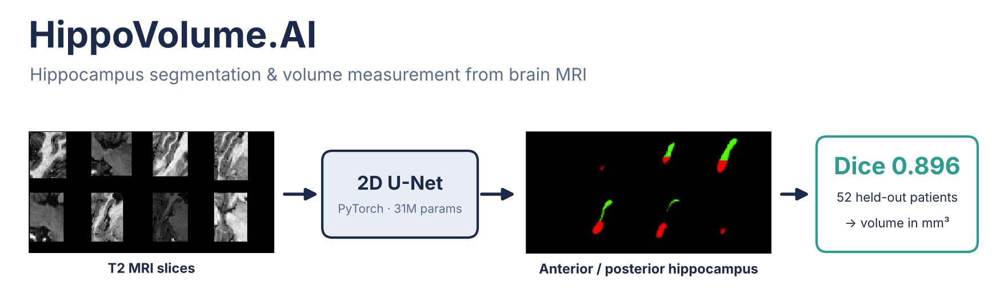
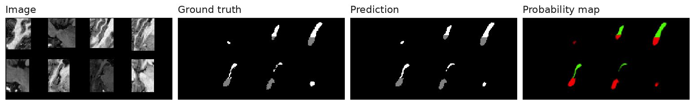

# HippoVolume.AI — Automated Hippocampal Volume Measurement from MRI



A 2D U-Net that segments the hippocampus in brain MRI and reports its volume in mm³. The end goal is a clinical tool for tracking Alzheimer's disease progression: the model runs on each new study in a PACS and sends a volume report back to the radiologist's viewer.

> Capstone project of the Udacity **AI for Healthcare** Nanodegree. The task definition and starter code skeleton come from Udacity; the data curation, training pipeline, evaluation and analysis are my own.

## Results (52 held-out test patients)

| Metric | Result |
|---|---|
| **Mean Dice** | **0.896** |
| **Mean Jaccard (IoU)** | **0.813** |
| Mean sensitivity | 0.875 |
| Mean specificity | 0.998 |

Patient-level split (60/20/20, seed 42), so no slices of a test patient were seen in training. Whole 3D volumes are evaluated slice by slice, the same way the model runs in deployment.



**Key finding:** the model **under-segments**. Sensitivity (0.875) is lower than precision (~0.92), so predicted volumes tend to be slightly too small. Since a small hippocampus is the warning sign in Alzheimer's disease, this bias must be measured and corrected before clinical use. Details in [`section2/out/README.md`](section2/out/README.md).

## Project status

| Section | Content | Status |
|---|---|---|
| 1. Data curation | EDA of NIfTI volumes and headers, voxel-size and volume checks, outlier removal → 260 clean image/label pairs | ✅ Done |
| 2. Model | 2D recursive U-Net (PyTorch), training pipeline, TensorBoard logging, per-patient metrics | ✅ Done — [results](section2/out/README.md) |
| 3. Clinical integration | DICOM routing (Orthanc PACS → AI server), inference on new studies, DICOM report viewable in OHIF, validation plan | 🚧 In progress |

## Method

- **Data:** Hippocampus task of the [Medical Segmentation Decathlon](http://medicaldecathlon.com/) — cropped T2 MRI volumes with anterior/posterior hippocampus labels.
- **Preprocessing:** per-volume max normalization; zero-padding to 64×64 (no resizing, so physical voxel size and mm³ volumes stay correct).
- **Model:** recursive 2D U-Net (DKFZ implementation), 3 classes, ~31M parameters.
- **Training:** cross-entropy, Adam (lr 2e-4), batch 8, 10 epochs (~37 min on Apple Silicon / MPS).
- **Evaluation:** Dice, Jaccard, sensitivity and specificity on binarized masks, per patient.

## Quickstart

```bash
conda env create -f section2/src/environment.yml
conda activate medai
cd section2/src
python run_ml_pipeline.py            # set Config.smoke_test = True for a 30-second end-to-end check
tensorboard --logdir runs
```

Data is not tracked in git: put the curated `images/` and `labels/` folders in `section1/out/` (path set in `Config.root_dir`). The device is picked automatically (CUDA → MPS → CPU).

## Repository structure

```
section1/   EDA notebook and dataset curation
section2/   training pipeline (src/) and results (out/)
section3/   PACS/OHIF integration and DICOM report generation (in progress)
```

## Next steps

- Dice or Dice + cross-entropy loss to reduce under-segmentation
- Best-checkpoint selection and early stopping (validation loss plateaus after ~4 epochs)
- Per-class (anterior / posterior) metrics
- 2.5D / 3D U-Net to use context across slices

## Acknowledgments

Project framework and starter code by Udacity (AI for Healthcare Nanodegree). U-Net implementation by DKFZ. Dataset: Medical Segmentation Decathlon (Simpson et al., 2019).
